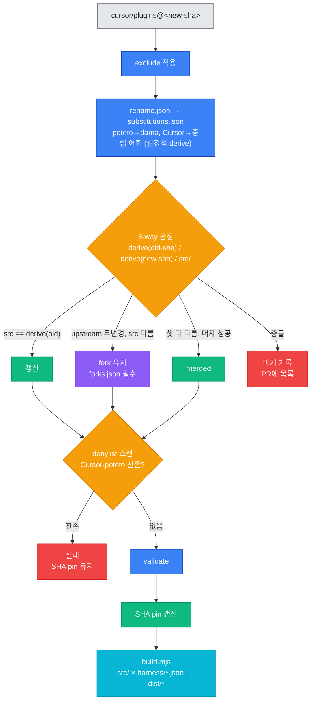

# orcstack 보일러플레이트 계획

- 작성일: 2026-11-05
- 기준 철학: [`docs/philosophy.md`](philosophy.md)
- Upstream: [cursor/plugins/pstack](https://github.com/cursor/plugins/tree/main/pstack) — MIT, Lauren Tan, v0.15.36 (`c742dd6`)
- 상태: 계획. M0 스파이크 완료(2026-11-06), 결과는 [`docs/spikes/`](spikes/)

## 0. 한 줄 정의

orcstack은 orcstack용 pstack 파생 플러그인이다. pstack의 **pstack-governed 운영 규칙**을 따르고, orcstack 철학(Planning SSOT, work brief, ADR, 래칫 TDD, Tier 0–3 CI, cold-start review)을 더한다. SDD와 함께 쓰는 보완재가 **아니며**, orcstack을 도입하면 SDD는 걷어낸다. 같은 이유로 **Spec Kit, Superpowers와도 혼용할 수 없다**(2절).

orcstack은 **Cursor에 의존하지 않는다.** upstream은 Cursor를 정본으로 두고 다른 하네스에서는 런타임에 Cursor 이름을 번역하게 한다. orcstack은 반대로 Claude Code, Codex, oh-my-pi, opencode를 1급 지원 대상으로 두고, Cursor 이름·기능은 upstream을 가져올 때 제거한다(7절).

### 페르소나와 출처 명시

- orcstack의 화자는 **Orc (오크)** 다. upstream README의 1인칭 화자 poteto 자리를 오크가 맡는다.
- 포팅 사실을 숨기지 않는다. README 첫 문단 고정 문구:

  > 난 오크 이고, 옆동네 Poteto 를 벤치마크했다.
  >
  > I'm Orc (오크). orcstack is a port of [Poteto Stack (pstack)](https://github.com/cursor/plugins/tree/main/pstack) by Lauren Tan ([@poteto](https://github.com/poteto)), reshaped for orcstack.

- 출처 표기 위치: README 첫 문단, `NOTICE.md`(upstream MIT 고지 + 기준 SHA), 각 매니페스트 `description` 끝("Port of Poteto Stack (pstack) by Lauren Tan."), `orc-help` 소개.
- 오크는 orcstack 목소리일 뿐, Lauren Tan이나 Cursor의 공식 프로젝트처럼 보이게 하지 않는다. 원저작자 표기는 그대로 남긴다.

## 1. 가능성 검토

| 항목 | 판단 | 근거 |
|---|---|---|
| 라이선스 | 가능 | MIT. 저작권 고지를 보존하면 fork·수정·재배포·rename 모두 허용. `LICENSE` + `NOTICE.md`에 Lauren Tan 고지 유지 |
| 멀티 하네스 | 가능(실측) | M0에서 임시 플러그인으로 Claude Code·Codex·oh-my-pi·opencode 모두 `orc-mode` → playbook 라우팅 확인([하네스 실측](spikes/harness-mapping.md)). 선례: `michael-denyer/pstack-claude`, `potetos-for-everyone`, Superpowers(한 저장소에서 10여 개 하네스) |
| 주기적 upstream 수용 | 가능, 단 도구가 필수 | upstream 변경 빈도가 높다(최근 15개 커밋이 수 주 내). 손으로 머지하면 rename 때문에 매번 충돌. `pstack-claude`의 `tools/sync.mjs`(SHA pin + exclude + substitution + forks 레지스트리 + 3-way merge)가 정확히 이 문제를 푼 선례 |
| poteto → dama rename | 가능 | `poteto*` 토큰은 36개 파일에 약 290회(`poteto-mode` 250, `poteto-agent` 17, `poteto-help` 13 등). 기계적 치환은 쉽다. 단, README·guide의 1인칭 목소리("i'm poteto", "my style")는 치환이 아니라 재작성 대상 |
| orcstack 철학 결합 | 가능, 일부는 upstream과 정면 충돌 | 아래 3절 참고. 충돌 지점은 **policy fork**로 관리해야 sync가 유지된다 |
| SDD·Spec Kit·Superpowers 배제 | 가능 | pstack 자체에 planning skill이 없어 계획·명세 문서를 만들지 않는다. orcstack은 여기에 "감지 → 컷오버 → 재유입 차단"을 강제 장치로 추가 |

### 주요 리스크

1. **Sync 비용 누적**: fork한 파일이 많을수록 upstream 갱신 때 충돌이 늘어난다. → rename을 "파생(derive) 단계의 결정적 변환"으로 처리하고, 철학 fork는 꼭 필요한 파일로 한정. 신규 dama skill은 upstream과 겹치지 않는 별도 디렉터리로 둔다.
2. **Cursor 의존성**: upstream 본문에 Cursor 이름·경로·기능이 박혀 있다. M0 측정([derive 잔존](spikes/derive-residue.md)): rename 417곳·중립 치환 148곳은 기계 처리되고, 남는 102줄 중 통째 재작성 파일 밖에서 손볼 곳은 17개 파일 35줄이다. → 7절의 중립 어휘 + 빌드 타임 번역으로 제거하고, denylist로 재유입을 막는다.
3. **oh-my-pi 도구 격차**: 해소. oh-my-pi에 `task`(subagent), `todo`, `ask`(대화형)가 내장돼 있어 extension이 필요 없다.
4. **opencode**: 플러그인 매니페스트가 아니라 skills 디렉터리(`.agents/skills`, `.opencode/skills`) 기반 설치. 훅이 없지만 `AGENTS.md` 지시만으로 라우팅됨을 확인했다.
5. **두 upstream 추적 유혹**: `pstack-claude`를 두 번째 upstream으로 삼으면 번역 비용은 줄지만 추적 대상이 둘이 된다. → **upstream은 `cursor/plugins` 하나**. `pstack-claude`(MIT)는 sync 도구·하네스 adapter의 참고/차용 대상으로만 쓴다(차용 시 NOTICE에 고지).

## 2. 운영 규칙: 다른 워크플로 프레임워크와 혼용 금지 (Golden Rule)

orcstack 철학의 "한 경계·한 마일스톤에 운영 규칙 하나, 두 워크플로를 같은 변경에 중첩하지 않는다"를 orcstack에서는 **고정 규칙**으로 둔다.

- orcstack을 쓰는 저장소의 운영 규칙은 항상 **orcstack-governed**(= pstack-governed + orcstack 정책)다.
- 아래 프레임워크는 orcstack과 **함께 쓸 수 없다.** 보완재로도, 일부 skill만 빌려 쓰는 방식으로도, 사후 동기화 용도로도 쓰지 않는다.
- 다른 프레임워크 → orcstack 전환은 마일스톤 경계에서 **clean cutover**로만 한다.

### 혼용 불가 프레임워크

| 프레임워크 | 성격 | orcstack과 충돌하는 지점 | 감지 신호 |
|---|---|---|---|
| **SDD** (`sdd-helper`) | 문서 선행 운영 규칙. `requirements.md → specs.md → plans.md → 구현`, `FR-X → TS-X → Step N` 추적 | 진실의 원천이 둘이 된다(SDD 문서 vs Planning SSOT·코드·증거). 사후 동기화는 SDD의 forward traceability를 깨고, 탐색 전 문서화는 orcstack의 경험적 수렴을 막는다 | `specs/<slug>/requirements.md·specs.md·plans.md`(복수형), `FR-`/`TS-` ID(보조), `sdd-helper@synapse-marketplace` 활성 |
| **Spec Kit** (`github/spec-kit`) | 스스로 Spec-Driven Development라 부르는 SDD 구현. `constitution → specify → plan → tasks → implement → converge` | SDD와 같은 이유. 추가로 constitution이 Planning SSOT·ADR과 권위를 다투고, tasks 목록이 orcstack의 work brief·playbook 순서와 겹친다 | `.specify/`, `specs/NNN-<name>/spec.md·plan.md·tasks.md`(단수형), 하네스별 명령 파일(`.claude/skills/speckit-*`, `.agents/skills/speckit-*`, `.opencode/commands/speckit.*`, `.omp/commands/speckit.*`) |
| **Superpowers** (`obra/superpowers`) | 세션 시작 시 주입되는 **필수 워크플로 라우터**("Mandatory workflows, not suggestions"). `brainstorming → 설계 문서 → writing-plans → executing/subagent-driven → TDD → code review → finish branch` | ① 라우터가 둘이 된다: `using-superpowers`와 `orc-mode`가 같은 작업을 서로 다른 playbook으로 보낸다. ② 계획 선행: 2–5분 단위 task에 "complete code"까지 담는 plan이 orcstack의 investigate → prototype → converge 흐름과 정면 충돌. ③ TDD 강제: "테스트보다 먼저 쓴 코드는 삭제"가 orcstack의 조건부 test-first·crank/ratchet 구분·prototype 허용과 충돌. ④ 설계·계획 문서가 Planning SSOT와 별개의 기록으로 쌓인다 | `docs/superpowers/specs/*-design.md`, `docs/superpowers/plans/*.md`, 플러그인 활성(`superpowers@claude-plugins-official` 등, opencode `plugin(s)`), 세션 표지 `<EXTREMELY_IMPORTANT>` + `You have superpowers.` |

감지 신호의 근거와 하네스별 설정 위치는 [혼용 프레임워크 감지 신호](spikes/framework-signals.md)에 있다. SDD와 Spec Kit은 둘 다 `specs/`를 쓰므로 안쪽 파일 이름(복수형 vs 단수형)과 `.specify/` 유무로 구분한다.

### orcstack 인접 플러그인

| 플러그인 | 처리 |
|---|---|
| `tmux-orchestrator` | SDD 문서(`requirements/specs/plans`)를 만들고 `plans.md`를 작업 순서의 권위로 쓴다. **혼용 금지 대상.** orcstack-governed 저장소에서는 끈다. 입력을 work brief로 바꾸는 일은 orcstack 범위 밖이다 |
| `platform-dev-team-common`의 `tdd-workflow` | "항상 TDD"를 강제해 orcstack `tdd`와 부분 충돌한다. 같은 플러그인의 다른 skill은 도구 성격이다. **플러그인은 켜 두고**, `adopt-orcstack`이 "검증 순서는 orcstack `tdd`가 정한다"는 프로젝트 규칙을 쓴다. 감지는 하되 차단하지 않는다 |
| `local-memory`의 `sync-specs` | 도구. 컷오버 후 입력이 없어질 뿐이다 |

공통 원인은 하나다. 셋 다 **자기 자신이 작업 순서와 진실의 원천을 정하는 운영 규칙**이다. orcstack도 운영 규칙이므로 같은 저장소·같은 마일스톤에 둘이 있으면 어느 쪽 순서를 따를지, 어느 문서가 권위인지가 매 변경마다 흔들린다.

혼용 금지가 아닌 것: 개별 도구 성격의 skill(코드 리뷰 봇, 문서·차트 생성, 언어별 best practice 등)은 순서·권위를 주장하지 않으므로 함께 써도 된다. 판단 기준은 "작업 순서를 정하거나, 별도의 계획·명세 문서를 권위로 만드는가"다.

### `adopt-orcstack` (컷오버 skill, 최우선 구현)

1. **감지**: 위 표의 감지 신호 전부와 orcstack 인접 플러그인. 프로젝트·유저 설정의 플러그인 활성 여부 포함: Claude Code `enabledPlugins`, Codex `config.toml`의 `[plugins."<name>@<marketplace>"]`, opencode `opencode.json`의 `plugin`/`plugins`, oh-my-pi 설치 기록.
2. **동결**: 기존 문서를 `docs/archive/<framework>/`(`sdd`, `speckit`, `superpowers`)로 옮기고 각 파일 상단에 `FROZEN (read-only) since <milestone>` 헤더. 수정 금지.
3. **의도 승격**: 동결 문서에서 **제품 의도만** 추출해 Planning SSOT(`docs/planning/SSOT.md`)로 옮긴다. 기술 결정은 ADR로, 회귀 약속은 guard로. 계획·tasks·constitution의 절차 규칙은 승격하지 않는다.
4. **비활성화**: 프로젝트 설정에서 해당 플러그인을 끈다(Claude Code는 `enabledPlugins`에 `false`). 유저 전역에 설치돼 있으면 프로젝트 단위로 끄고, 끌 수 없는 하네스는 제거 절차를 안내한다. SessionStart 부트스트랩(`using-superpowers` 등)이 남아 있으면 컷오버 미완료로 본다.
5. **기록**: `docs/adr/0001-adopt-orcstack.md` — 전환 마일스톤, 걷어낸 프레임워크, 이유, 동결 경로.
6. **재유입 차단**: Tier 0 fitness function — 컷오버 이후 `docs/archive/` 밖에 위 감지 신호의 산출물(SDD 문서, `.specify/`, superpowers 계획 문서)이 추가되면 CI 실패.
7. **orc-mode 게이트**: 세션 시작이나 `orc-mode` 진입 시 감지 신호가 하나라도 있고 컷오버 ADR이 없으면, 작업을 시작하지 않고 `adopt-orcstack`으로 라우팅한다. 다른 프레임워크의 라우터 지시가 컨텍스트에 함께 들어와 있으면 그 사실을 보고하고 멈춘다.

## 3. 철학 결합 맵 (upstream skill → orcstack 처리)

### 이름 매핑 (`sync/rename.json`)

| upstream | orcstack |
|---|---|
| `pstack` | `orcstack` |
| `poteto-mode` | `orc-mode` |
| `poteto-help` | `orc-help` |
| `poteto-agent` | `orc-agent` |
| `poteto-mode-tools` | `orc-mode-tools` |
| `setup-pstack` | `setup-orcstack` |
| `pstack-models.md(c)` | `orcstack-models.md` |
| `poteto` (화자·1인칭 목소리) | 기계 치환 금지 → denylist로 잡고 **Orc (오크)** 화자로 수동 재작성 |
| `poteto` / `pstack` (출처·고지 문맥) | 유지. 출처 명시 허용 목록(allowlist)에 등록 |

순서 있는 단어경계 치환. 치환 후 `poteto`·`pstack`이 남으면 빌드 실패. 단 allowlist(README 출처 문단, `NOTICE.md`, 매니페스트 출처 문구, upstream 링크)는 예외.

### Skill 분류 (upstream SKILL.md 58개, principle 24개, playbook 23개)

| 분류 | 대상 | 처리 |
|---|---|---|
| Rename만 | `how`, `why`, `architect`, `arena`, `swarm`, `interrogate`, `unslop`, `no-comments`, `technical-writing`, `blast-radius`, `sharpen`, `reflect`, `in-your-own-words`, `show-me-your-work`, `figure-it-out`, `teach`, `statechart`, `create/maintain-verification-skill`, `create/maintain-formal-verification-skill`, `principle-*` 전부 | 파생 시 자동. fork 없음 |
| Policy fork | `orc-mode`(SKILL.md), `tdd`, `correct`, `recall`, playbook: `feature`, `bug-fix`, `refactoring`, `prototype`, `multi-phase-plan`, `opening-a-pr`, `shipping`, `session-pickup`, `pause-safely` | `sync/forks.json`에 파일별 이유·since 기록. 아래 정책 표 참고 |
| 재작성 | `setup-orcstack`, `orc-help`, README, guide | 화자를 오크로, 포팅 출처 명시, Cursor 전제 제거, orcstack 기본 모델·하네스 |
| 제외 | `ketchup`, `ketchup-video`, `bro`, `make-bot-ui`, `automate-me`, `automations/benny`, `assets/`, Cursor bugbot reference, `docs/harness/`(런타임 adapter) | `sync/upstream.json`의 `exclude` |
| 코드는 그대로 | `skills/*/scripts/**` (예: `watch-pr`의 Bugbot 분기 22줄) | fork하지 않는다. denylist는 skill 본문(`.md`)에만 적용한다. Bugbot이 없는 저장소에서는 그 분기가 돌지 않는다 |

### Policy fork 정책 (orcstack 철학 → skill)

| orcstack 원칙 | 반영 위치 |
|---|---|
| Planning SSOT가 공통 upstream, 변경마다 SSOT 섹션을 참조하는 work brief | `orc-mode` 시작 단계, `feature` 플레이북 |
| SDD 산출물 금지, SDD 흔적 시 `adopt-orcstack` 라우팅 | `orc-mode` |
| Acceptance 사전 정의(기대/금지 결과, 부작용, 불변식, guard + surface 매핑) | `feature` |
| Red-before-green, 고비용·재발 버그는 영구 래칫, guard 불가 시 사유·잔여 위험·승인자 기록 | `bug-fix`, `tdd` |
| TDD = crank + ratchet, crank 테스트는 계약을 지키지 않으면 정리 | `tdd` |
| Guard는 가장 낮은 안정 계층(architecture → types → lint → unit/property → integration → narrow E2E) | `tdd`, `correct` |
| Characterization test는 scaffolding vs 영구 fence 구분 | `refactoring` |
| Prototype은 머지 금지, 교훈만 승격(SSOT → ADR → guard) | `prototype` |
| Multi-phase plan은 임시, 커밋된 SSOT·ADR이 영속 기록 | `multi-phase-plan` |
| PR 본문: brief 링크, 계약별 guard / one-off evidence / no-guard 사유, Tier 증거 | `opening-a-pr` |
| Tier 3 독립 검증은 CI를 대체하지 않음 | `shipping` |
| 결정 기록은 로컬이 아닌 커밋된 팀 기록 | `recall`, `session-pickup`, `pause-safely` |

### Dama 전용 신규 skill

| skill | 역할 |
|---|---|
| `adopt-orcstack` | SDD 컷오버 + 저장소 스캐폴딩(SSOT, ADR 템플릿, CI tier, PR 템플릿, CODEOWNERS) |
| `work-brief` | SSOT 섹션 참조 짧은 brief + acceptance |
| `adr` | 경량 ADR, `Superseded` 수명주기, 덮어쓰기 금지 |
| `ci-tiers` | Tier 0/1/2 워크플로 스캐폴딩, 단일 명령 commit build, 시간 예산, fitness function |
| `test-audit` | 6가지 질문 + 삭제 기준(교체 guard와 red 증거 필수) |
| `cold-start-review` | 5가지 질문 게이트, 중요한 경계 변경의 최종 머지 게이트 |
| `contract-inventory` | 계약의 논리적 뷰(행위, 의도, 실패 비용, 신호, guard, 증거, 소유자) |

## 4. 저장소 레이아웃

```
orcstack/
├─ src/                           # 정본 — 하네스 중립 어휘, Cursor 토큰 0
│  ├─ skills/                      # upstream 파생 + dama 전용
│  └─ agents/                      # orc-agent.md, comment-sicko.md
├─ harness/                        # 하네스별 능력 표 + 하네스 고유 파일
│  ├─ claude-code.json  codex.json  omp.json  opencode.json
│  └─ hooks/                       # SessionStart 라우팅(옵트아웃 ORCSTACK_AUTO_ACTIVATE=0). Claude Code·Codex 공용 형식
├─ dist/                           # 생성물, 커밋함 (설치 대상). 손으로 고치지 않는다
│  ├─ claude-code/                 # .claude-plugin/plugin.json + 번역된 skills·agents·hooks
│  ├─ codex/                       # .codex-plugin/plugin.json + 번역된 skills + hooks(사용자 신뢰 승인 필요)
│  ├─ omp/                         # Claude 플러그인 형식 + omp용 도구 이름. 훅 없음
│  └─ opencode/                    # .agents/skills 트리 + AGENTS.md 조각 + 설치 스크립트
├─ templates/                      # adopt-orcstack이 대상 저장소에 생성하는 파일
│  ├─ docs/planning/SSOT.md
│  ├─ docs/briefs/_template.md
│  ├─ docs/adr/0000-template.md
│  ├─ .github/workflows/orcstack-tier{0,1,2}.yml
│  └─ .github/pull_request_template.md
├─ sync/
│  ├─ upstream.json                # remote, SHA pin, exclude
│  ├─ rename.json                  # poteto→dama 결정적 치환
│  ├─ substitutions.json           # Cursor 토큰 → 중립 어휘, 링크·경로 치환
│  ├─ denylist.json                # 남으면 안 되는 토큰(poteto, Cursor 이름·경로·기능, requirements.md 생성 지시 등)
│  └─ forks.json                   # 의도적 분기 파일 + why + since
├─ tools/
│  ├─ sync.mjs                     # upstream → src/ (derive → 3-way merge → pin 갱신)
│  ├─ build.mjs                    # src/ + harness/*.json → dist/<harness>/
│  ├─ validate.mjs                 # frontmatter, 링크, denylist, 매니페스트 버전 일치, dist 최신 여부
│  └─ check-no-sdd.mjs             # orcstack 자신과 템플릿용 SDD 재유입 검사
├─ tests/                          # tools/* 테스트 (Tier 1)
├─ docs/
│  ├─ planning/SSOT.md             # orcstack 자체의 Planning SSOT (dogfood)
│  └─ adr/0001-orcstack-governed.md
├─ .claude-plugin/marketplace.json # Claude Code(orcstack → dist/claude-code)와 oh-my-pi(orcstack-omp → dist/omp) 항목
├─ .agents/plugins/marketplace.json# Codex 마켓플레이스 → dist/codex
├─ package.json                    # 도구 스크립트(node ≥ 22). 하네스 매니페스트 아님
├─ AGENTS.md, CLAUDE.md
├─ LICENSE (MIT, orcstack + Lauren Tan 고지), NOTICE.md, CHANGELOG.md, VERSION
```

- 버전: orcstack 자체 semver + `CHANGELOG`/`VERSION`에 `upstream: pstack 0.15.36 (c742dd6)` 병기.
- orcstack 저장소 자체도 orcstack-governed로 운영(dogfood). 이 저장소에서는 전역 `sdd-helper`를 프로젝트 설정으로 비활성화.

## 5. Upstream sync 파이프라인



- 주기: 주 1회 스케줄 GitHub Action이 upstream `main` 최신 SHA로 `sync.mjs` 실행 → 변경 있으면 PR 생성(충돌·신규 skill·삭제 목록 포함). 머지는 사람이.
- 신규 upstream skill은 기본 "rename만"으로 들어오되 PR에서 분류(유지/fork/제외) 결정.
- forks.json에 없는 분기 파일이 생기면 실패 → 의도치 않은 drift 차단.

## 6. 하네스별 제공 방식

M0 실측([하네스 실측](spikes/harness-mapping.md)) 기준이다.

| 하네스 | 설치 | 호출 | 라우팅 | 비고 |
|---|---|---|---|---|
| Claude Code | `/plugin marketplace add hwangjongtaek/orcstack` → `/plugin install orcstack@orcstack` | `/orcstack:orc-mode`, 자연어 | SessionStart 훅(옵트아웃) | `dist/claude-code` |
| Codex | `codex plugin marketplace add hwangjongtaek/orcstack` → `codex plugin add orcstack@orcstack` | `$orc-mode`, 자연어 | `AGENTS.md` 지시(기본) + SessionStart 훅(보조) | 훅은 사용자가 TUI에서 한 번 신뢰 승인해야 돌고, 승인 전에는 조용히 꺼져 있다. 훅 정의가 바뀌면 재승인. 설치본은 `$CODEX_HOME/plugins/cache`로 복사되므로 갱신은 `marketplace upgrade` 후 재설치 |
| oh-my-pi | `omp plugin marketplace add hwangjongtaek/orcstack` → `omp plugin install orcstack-omp@orcstack` (Claude 마켓플레이스 형식) | `/skill:orc-mode`, 자연어 | `AGENTS.md` 지시 | Claude 형식 훅을 실행하지 않는다. upstream pi와 `package.json` `"pi"` 필드는 지원하지 않는다 |
| opencode | 설치 스크립트가 skills를 `.agents/skills`(또는 `.opencode/skills`)에 링크하고 `AGENTS.md` 블록 추가 | `skill` 도구, 자연어 | `AGENTS.md` 지시 | 플러그인 매니페스트 없음. opencode는 `.claude/skills`·`CLAUDE.md`도 읽으므로 중복 노출 주의 |

`.agents/skills/`는 Codex·oh-my-pi·opencode가 공통으로 읽는다. 플러그인 없이 이 디렉터리와 `AGENTS.md`만으로도 세 하네스에서 라우팅된다. 다만 도구 이름이 하네스마다 달라 렌더링은 하네스별로 한다.

전략: **중립 어휘로 쓴 정본 + 하네스별 빌드 타임 번역**. upstream처럼 런타임 adapter 문서로 Cursor 이름을 번역하게 하지 않는다(토큰 낭비, 오적용 위험). 자세한 내용은 7절.

## 7. Cursor 의존성 제거

### 원칙

- 정본(`src/`)은 **하네스 중립 어휘**로 쓴다. Cursor 이름도, 특정 하네스 이름도 쓰지 않는다.
- 하네스별 산출물은 `harness/<name>.json` 능력 표로 **빌드 타임에 번역**한다. 런타임 번역 문서는 두지 않는다.
- 하네스에 없는 능력은 "skip"이 아니라 **선언된 대체 경로**로 내려간다(예: subagent 없음 → 같은 세션에서 순차 실행 + 그 사실을 보고).
- Cursor 전용 기능에 기대는 단계는 orcstack 기능으로 다시 설계하거나 제거한다.

### 중립 어휘 → 하네스 매핑 (`harness/*.json`)

M0 실측으로 채웠다. 정본은 `{{capability}}` 토큰으로 쓰고 하네스별로 렌더링한다([ADR-0003](adr/0003-neutral-capability-tokens.md)). 렌더링 문구의 정본은 `harness/*.json`이고, 이 표는 요약이다. 모델 시트는 skill이 읽는 일반 파일이며, 하네스의 모델 설정(`settings.json` `model`, `config.toml` `model`, `config.yml` `modelRoles`, `opencode.json` `model`)은 건드리지 않는다. "대화형"은 headless 실행에서는 빠지는 도구다.

| 중립 능력 | upstream(Cursor) | Claude Code | Codex | oh-my-pi | opencode |
|---|---|---|---|---|---|
| `spawn-subagent` | `Task`, `generalPurpose` | `Agent` | `spawn_agent` (+ `wait_agent`, `send_message`) | `task` (+ `wait`) | `task` |
| `spawn-readonly` | `readonly: true` | 읽기 전용 agent 타입 + "편집 금지" 문구 | sandbox `read-only` | "편집 금지" 문구 | plan 계열 agent |
| `isolated-worktree` | `environment: "cloud"`, `cloud_base_branch` | `EnterWorktree`, agent worktree 격리 | `--worktree`, `git worktree` | `git worktree` | `git worktree` |
| `ask-user` | `AskQuestion` | `AskUserQuestion` (대화형) | `request_user_input_async` | `ask` (대화형) | `question` (대화형) |
| `todo` | todolist | 도구 없음 → 본문 체크리스트 | 도구 없음(`create_goal`·`update_goal`이 가장 가깝다) → 본문 체크리스트 | `todo` | `todowrite` |
| `run-skill` | `/name` | `/orcstack:<name>` | `$<name>` | `/skill:<name>` | `skill` 도구 |
| `project-rule` | `.cursor/rules/*.mdc` | `CLAUDE.md` | `AGENTS.md` | `AGENTS.md` | `AGENTS.md` |
| `session-hook` | custom mode | 플러그인 `SessionStart` | 플러그인 `SessionStart`(신뢰 승인 후) | 없음 | 없음 |
| `model-sheet` | `~/.cursor/rules/pstack-models.mdc` | `~/.claude/orcstack-models.md` | `~/.codex/orcstack-models.md` | `~/.omp/agent/orcstack-models.md` | `~/.config/opencode/orcstack-models.md` |
| `model-default` | 모델 slug(`grok-…`, `claude-…`) | 세션 모델 상속 | 세션 모델 상속 | 세션 모델 상속 | 세션 모델 상속 |
| `transcripts` | `~/.cursor/projects/*/agent-transcripts` | `~/.claude/projects/<slug>/*.jsonl` | `$CODEX_HOME/sessions/YYYY/MM/DD/rollout-*.jsonl` | `~/.omp/agent/sessions/<cwd-slug>/` | SQLite `~/.local/share/opencode/opencode.db` |
| `worktree-root` | `.cursor/worktrees/` | 하네스 기본 worktree 경로 | `git worktree list` | `git worktree list` | `git worktree list` |
| `surface-check` | `cursor-team-kit`의 `control-ui`·`control-cli` | 저장소의 Feature Map + verify skill(`create-verification-skill`로 만든 것) | 같음 | 같음 | 같음 |
| `loop` / `schedule` | Cursor `/loop`, Automations | `/loop`, `ScheduleWakeup` | 없음 → 외부 cron/CI | 없음 → 외부 cron/CI | 없음 → 외부 cron/CI |

### Cursor 전용 기능 처리

| upstream 기능 | orcstack 처리 |
|---|---|
| Bugbot (리뷰 봇·triage reference) | 제거. 리뷰 스레드 처리는 `gh`로 일반 PR 리뷰 스레드를 다룬다. 자동 리뷰는 orcstack `interrogate`/`swarm` 서브에이전트 리뷰로 대체 |
| Cursor Automations, `benny` | 제거. 정기 작업은 Tier 2 nightly CI·GitHub Actions schedule로 |
| Cloud agents | `isolated-worktree`로 대체 |
| 내장 PR 도구 | `gh pr create` 등 forge CLI |
| custom mode(option+enter로 상주) | Claude Code SessionStart 훅, 그 외 하네스는 `AGENTS.md` 라우팅 지시 |
| 멀티모델 기본값(grok + opus 패널) | 하네스가 실제로 제공하는 모델만 쓰는 `setup-orcstack` 모델 시트. 기본은 세션 모델 상속. `arena`처럼 여러 모델이 필요한 skill은 하네스가 가진 모델 범위에서 동작하고, 단일 모델이면 같은 모델 다중 샘플로 내려간다 |
| `make-bot-ui`, canvas 류 | 제외 |
| Origin (Cursor 내부 forge CLI, 8개 파일 20줄) | 분기 삭제. forge는 `gh` 하나 |
| `cursor-team-kit` 의존(`control-ui`·`control-cli`) | `surface-check` 능력으로 추상화. 기본값은 저장소의 Feature Map과 verify skill. Tier 3 독립 검증과 같은 자리 |
| Cursor 내장 skill(`create-skill`, `babysit`, `/loop`) | `create-skill` → `authoring-a-skill` playbook 본문, `babysit` 충돌 경고 → 삭제, `/loop` → `loop` 능력 |

### 재유입 차단

- `sync/substitutions.json`이 Cursor 토큰을 중립 어휘로 바꾼다. 규칙 초안과 건수는 [derive 잔존](spikes/derive-residue.md)에 있다.
- `sync/denylist.json`에 `Cursor`, `.cursor/`, `.mdc`, `Bugbot`, `Automations?`·`automations/benny`·`benny`, `cloud agent`, `generalPurpose`, `AskQuestion`, `` `Task` ``, 모델 slug, `inherit-parent`, `agent-transcripts`, Origin forge, `cursor-team-kit`, `Application Support/Cursor`를 등록한다. `pstack`·`poteto`는 단어 경계로 검사한다(`upstack` 오탐 방지). 출처 고지 allowlist를 빼고 하나라도 남으면 sync와 빌드가 실패한다.
- denylist는 skill 본문(`.md`)에 적용한다. `scripts/` 코드는 fork하지 않으므로 검사에서 뺀다.
- 새 upstream skill이 Cursor 기능에 기대면 sync PR에서 "재설계 / 제외"를 결정하고 `forks.json`에 기록.

## 8. 단계별 계획

### P0. 스파이크 (가능성 실증) — 완료 2026-11-06
- 결과: [derive 잔존](spikes/derive-residue.md), [혼용 프레임워크 감지 신호](spikes/framework-signals.md), [하네스 실측](spikes/harness-mapping.md)
- 종료 기준 충족: 4개 하네스 모두 `orc-mode` → playbook 라우팅 동작, 매핑 표 "확인 필요" 0개

### P1. 보일러플레이트 골격
- 레이아웃(4절), LICENSE/NOTICE, 매니페스트, marketplace 파일
- `sync/*.json` 초판, `harness/*.json` 초판, `tools/sync.mjs`·`build.mjs`·`validate.mjs` + 테스트
- orcstack 자체 CI: Tier 0(validate, denylist, check-no-sdd(Spec Kit·Superpowers 산출물 포함), dist 최신 여부, < 2분) / Tier 1(tools 테스트)
- `docs/planning/SSOT.md`, `docs/adr/0001-orcstack-governed.md`

### P2. 첫 파생 (rename + Cursor 제거)
- upstream skill을 `src/`로 반입, 제외 목록 적용, Cursor 전용 단계 재설계(7절 표)
- README·guide·`setup-orcstack`·`orc-help` 재작성(오크 화자, 포팅 출처 고정 문구, Cursor 언급 없음)
- `build.mjs`로 `dist/claude-code` 생성
- Claude Code에서 `orc-mode` end-to-end

### P3. Dama 철학
- `adopt-orcstack` 최우선(SDD·Spec Kit·Superpowers 컷오버, 재유입 차단, orc-mode 게이트)
- 3절 policy fork 적용 + 신규 skill(`work-brief`, `adr`, `ci-tiers`, `test-audit`, `cold-start-review`, `contract-inventory`)
- `templates/` 완성

### P4. 하네스 확장
- `dist/codex`, `dist/omp`, `dist/opencode` 생성과 설치 스크립트

### P5. 운영
- 주간 upstream sync Action, 릴리스 태깅, CHANGELOG 자동화

## 9. 결정 사항

권장안을 채택했다(2026-11-06). 기록은 [ADR-0002](adr/0002-m0-decisions.md). 바꾸면 새 ADR을 쓰고 이 표를 함께 고친다.

| # | 결정 | 채택 |
|---|---|---|
| D1 | 배포 범위 | `hwangjongtaek/orcstack` private로 시작. 공개는 M5 이후 다시 판단 |
| D2 | skill 본문 언어 | 모든 skill 본문은 영어, 사람용 문서는 한국어 |
| D3 | SessionStart 자동 라우팅 | 기본 on, `ORCSTACK_AUTO_ACTIVATE=0`으로 끔. Claude Code는 훅, Codex는 `AGENTS.md` + 승인된 훅, oh-my-pi·opencode는 `AGENTS.md` |
| D4 | 기본 모델 | 세션 모델 상속(`model-default`) |
| D5 | 스크립트 런타임 | orcstack 도구는 node ≥ 22·의존성 0, upstream skill 스크립트는 bun 그대로 |
| D6 | upstream skill 스크립트 | fork하지 않는다. denylist는 `.md`에만 적용 |
| D7 | `cursor-team-kit` 의존 | `surface-check` 능력으로 추상화, 기본값은 Feature Map + verify skill |
| D8 | `tmux-orchestrator` | 혼용 금지 대상. orcstack-governed 저장소에서 끈다 |
| D9 | `tdd-workflow` | 플러그인은 켜 두고 프로젝트 규칙으로 orcstack `tdd` 우선 |
| D10 | Pi 지원 대상 | oh-my-pi. upstream pi는 지원하지 않는다 |
