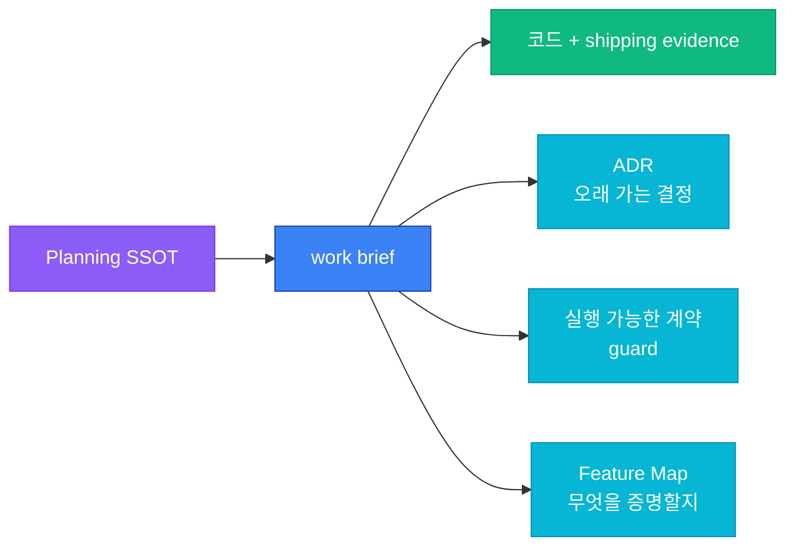

# orcstack 철학

orcstack이 pstack 위에 더하는 운영 원칙이다. skill과 playbook은 이 문서의 규칙을 구현하고, 충돌하면 이 문서가 기준이다.

## 네 개의 층

| 층 | 묻는 것 | orcstack에서 다루는 것 |
|---|---|---|
| 운영 규칙 | 변경은 어디서 시작하고, 무엇이 권위 있는 기준인가 | orcstack-governed 하나 |
| 검증 전략 | 어떤 약속을 영구 테스트로 남기고, 무엇을 일회성 증거로 둘 것인가 | TDD, 회귀 테스트, shipping evidence, Feature Map |
| CI 정책 | 무엇을 언제, 얼마의 비용으로 반복 실행하는가 | Tier 0–3, nightly, 독립 검증 |
| 지식 보존 | 코드 뒤의 이유는 어디에 남는가 | Planning SSOT, work brief, ADR, architecture map, cold-start review |

TDD, CI, ADR, Feature Map은 운영 규칙과 독립된 통제 장치다. 운영 규칙을 대신하지 않고, 의도나 작업 순서를 다시 정의하지도 않는다.

---

## 1. 운영 규칙

### 경계 하나, 마일스톤 하나, 운영 규칙 하나

- **운영 규칙**은 제품·프로젝트·독립 서브시스템이 물려받는 진실의 원천, 작업 순서, 필수 산출물, 완료의 정의를 묶은 것이다.
- 선택 단위는 기본적으로 제품이나 프로젝트다. 서브시스템은 고유한 공개 경계, 소유자, 릴리스 주기, 계약 기준선, 지표를 모두 가질 때만 별도 단위가 된다.
- 운영 규칙은 마일스톤 시작 시 정하고 끝날 때까지 유지한다. 티켓은 그 규칙을 물려받는다. 티켓마다 규칙을 바꾸지 않는다.
- orcstack을 쓰는 단위의 운영 규칙은 **orcstack-governed** 하나다.

### 다른 운영 규칙과 섞지 않는다

SDD, Spec Kit, Superpowers처럼 스스로 작업 순서와 권위 문서를 정하는 프레임워크는 orcstack과 함께 쓰지 않는다.

- 둘을 같이 돌리면 진실의 원천이 둘이 된다.
- 코드를 먼저 쓰고 문서를 나중에 맞추면 문서 쪽의 forward traceability가 깨진다.
- 모든 탐색을 먼저 문서로 쓰게 하면 코드·프로토타입·실행 결과로 수렴하는 orcstack의 방식이 막힌다.
- 같은 변경에 두 워크플로를 중첩하지 않는다. 다른 프레임워크의 문서를 "증거"로 사후 작성하지도 않는다.

### 전환은 마일스톤 경계에서만

- 다른 운영 규칙에서 orcstack으로 오는 전환은 다음 마일스톤 경계에서 **clean cutover**로만 한다.
- 이전 워크플로의 문서는 읽기 전용으로 동결한다. 제품 의도만 Planning SSOT로 옮긴다.
- 전환 결정은 보편적 주장이 아니라 **반증 가능한 운영 가설**로 기록한다(ADR).

### 운영 지표

마일스톤마다 같은 지표로 orcstack 운영 상태를 잰다.

- 결함 유출률과 심각도
- 아이디어에서 운영 반영까지의 리드 타임
- 재작업률(acceptance 변경 포함)
- 코드·문서·승인에 드는 리뷰 시간
- 개인 대화 기록 없이 맥락을 복원하는 cold-start 성공률
- 문서 drift와 유지 비용

### 프로토타입

- 프로토타입은 scratch 디렉터리나 격리된 브랜치에 두고, 운영 코드로 머지하지 않는다.
- 승격하는 것은 **교훈**뿐이다. 의도가 바뀌었으면 Planning SSOT를 먼저, 그다음 ADR·guard·계획을 고친다.
- 운영 구현은 처음부터 새로 쓴다.

---

## 2. 지식 보존

### 코드만으로는 제품을 설명할 수 없다

코드는 현재 동작을 보여준다. 그 동작이 왜 중요한지, 무엇을 버렸는지, 누가 위험을 소유하는지, 어떤 증거를 반복해야 하는지는 보여주지 않는다.

pstack은 한 변경의 slop을 잘 통제한다(`architect`의 설계 대안, scratch 프로토타입, 복잡도를 줄이는 원칙들, 작고 순서 있는 PR). 그러나 여러 변경에 걸친 **구조적 엔트로피**는 따로 통제하지 않는다.

- `architect`는 장기 시스템 목표를 유지하지 않는다.
- 프로토타입 결론이 계약으로 자동 승격되지 않는다.
- 작은 PR과 PASS 결과가 전체 구조를 증명하지 않는다.
- 반복 실패는 재발한 뒤에야 구조로 승격된다.
- 여러 단계 계획은 작업이 끝난 뒤 남지 않아도 된다.

그래서 orcstack은 **발견(discovery)과 전달(delivery)을 분리**하고, 결정을 각자의 자리로 승격한다. acceptance는 work brief로, 오래 가는 기술 결정은 ADR로, 회귀 약속은 영구 guard로.

### 산출물 사슬

- **Planning SSOT**: 제품 의도의 단일 원천. 의도 변경은 구현 전에 소유자 승인을 받아 여기부터 고친다.
- **Work brief**: 변경마다 쓰는 짧은 문서. 참조하는 SSOT 섹션과 acceptance를 담는다. 임시 구현 계획은 작업이 끝나면 지워도 되지만 brief와 SSOT는 커밋된 팀 기록으로 남는다.
- 결정 기록은 로컬 에이전트 저장소가 아니라 저장소에 커밋한다.

### ADR

- 테스트는 계약이 깨졌다고 알려주지만, 왜 중요한지와 언제 바꿔도 되는지는 알려주지 않는다.
- 오래 가거나 위험한 계약에만 경량 ADR을 쓴다: 선택지, 버린 대안, 제약, 실패 비용, 재검토 조건.
- 테스트 파일마다 쓰지 않는다.
- 승인된 ADR은 덮어쓰지 않는다. 계약이 바뀌면 새 ADR을 쓰고 이전 것을 `Superseded`로 표시한다.

### 계약 인벤토리

새 파일이 아니라 논리적 관점이다. 각 계약에 대해 다음을 답할 수 있어야 한다.

- 행위, 의도와 출처, 실패 비용, 관찰 가능한 신호
- 영구 guard(없으면 그 이유), shipping evidence
- 소유자와 변경 조건

Feature Map의 사용자 여정은 입력 중 하나일 뿐이다. 데이터 불변식, 멱등성, 권한 경계는 화면에 드러나지 않을 수 있다.

### 아키텍처 일관성

- 서브시스템마다 책임, 공개 경계, 허용 의존성, 데이터 소유자, 검증 명령, 소유자를 **한 곳**(architecture map 또는 README)에서 복원할 수 있어야 한다.
- 소유는 CODEOWNERS나 owner map으로 명시한다.
- 기계로 검사할 수 있는 경계(금지 import, 순환, 우회 경로, 호환성)는 architecture fitness function으로 Tier 0이나 Tier 1에서 강제한다.
- 중요한 경계 변경은 cold-start review를 최종 머지 게이트로 둔다.

### Cold-start test

구현에 참여하지 않은 동료가 저장소, 이슈, PR만으로 다음에 답할 수 있어야 한다.

1. 어떤 사용자 필요와 실패 비용이 이 변경을 정당화하는가?
2. 어느 서브시스템과 소유자가 책임지는가?
3. 어떤 대안을 버렸고, 언제 이 결정을 다시 봐야 하는가?
4. 무엇이 자동 guard이고, 무엇이 일회성 증거인가?
5. 어디까지 되돌릴 수 있고, 어떤 데이터나 외부 계약을 확인해야 하는가?

답하지 못하면 작업은 끝나지 않은 것이다. 빈칸은 orcstack 자신의 산출물로 채운다. 다른 프레임워크의 문서를 빌려 채우지 않는다.

---

## 3. 검증 전략

### TDD는 크랭크이자 래칫이다

- **래칫(ratchet)**: 영구 테스트는 이미 합의한 동작이 조용히 퇴행하지 못하게 막는다.
- **크랭크(crank)**: 쓸 만한 API를 찾으려고 테스트를 먼저 쓰는 일은 설계를 앞으로 민다.
- 문제는 크랭크용으로 쓴 테스트가 대부분 영구 자격이 없다는 것이다(인터페이스 탐색, mock 호출 순서, 타입이 이미 막는 오류). 쌓이면 그물이 아니라 갑옷이 된다.
- orcstack의 질문: TDD의 설계 추진력과 장기 회귀 신뢰를 지키면서, 가치 있는 톱니만 남기려면 어떻게 하는가?

pstack의 테스트 태도도 같은 방향이다. 테스트를 덜 쓰자는 것이 아니라 테스트에 더 엄격하자는 것이다.

- test-first는 싼 로컬 테스트 경로가 있는 버그 수정에 주로 쓴다. 경로가 불분명하거나 무거운 통합 인프라가 필요하면 건너뛴다.
- 버그는 같은 표면에서 재현하고, 같은 표면에서 검증한다. 단위 테스트는 분기 동작을 보여줄 뿐 버그가 없음을 증명하지 않는다.
- 리팩터링은 characterization test, snapshot, 동등성 하네스로 현재 동작을 고정한다. 컴파일과 타입 체크는 고정이 아니다.
- 좋은 테스트는 관찰 가능한 동작이 깨지면 실패하고, 내부만 바뀌면 통과한다.
- green CI는 필요조건이지 충분조건이 아니다.

### Hard TDD의 비용

- 같은 계약을 unit, integration, E2E에서 중복 검증하고, 어떤 층은 고유한 실패 신호가 없다.
- private helper와 호출 순서에 묶인 테스트가 리팩터링마다 깨진다.
- 커다란 fixture와 mock 그래프가 두 번째 프로그램이 된다.
- 느리거나 flaky한 테스트가 모든 PR을 늦추고, 사람들이 재실행에 익숙해진다.
- 그 테스트가 어떤 퇴행을 막는지 아무도 말하지 못한다.

### 증거의 두 시간 축

| 장치 | 묻는 것 | 언제 | 강점 | 빈틈 |
|---|---|---|---|---|
| Shipping evidence | 이 변경이 지금 제품 표면에서 동작하는가 | PR·릴리스마다 한 번 | UI, CLI, API, 부작용을 실제로 확인 | 다음 변경 때 다시 돈다는 보장이 없다 |
| 영구 회귀 guard | 미래의 변경이 이 계약을 깼는가 | 관련 커밋·PR마다 | 합의한 계약을 계속 지킨다 | 잘못 두거나 mock하면 제품 동작과 어긋난다 |

green CI만으로는 출시를 믿기 어렵고, 제품 표면 PASS 한 번은 다음 달을 지켜주지 못한다. 둘 다 필요하다.

### Feature Map

- 기능별로 사용자 관점, 진입점, 하네스, 관찰 가능한 성공, 함정을 정리한 **행위 카탈로그**다. CI를 대신하지 않는다.
- Feature Map = 무엇을 증명할지. CI guard = 무엇을 자동으로 반복할지. 독립 검증 = 이 결과물이 표면에서 계약을 만족하는지.

### guard는 가장 낮은 안정 계층에

1. **아키텍처**: 잘못된 쓰기 경로를 불가능하게, 진실의 원천은 하나로
2. **타입·스키마**: 잘못된 상태를 표현할 수 없게
3. **Lint·정적 규칙**: 금지 import와 위험한 호출 패턴을 실행 전에
4. **Unit·property 테스트**: 순수하고 안정적인 계약(가격 계산, 파서, 상태 전이)
5. **Integration·contract 테스트**: 직렬화, DB 트랜잭션, 외부 프로토콜처럼 경계 자체가 계약인 곳. 그 경계를 mock으로 지우지 않는다
6. **좁은 E2E**: 층 사이 상호작용이 위험인 핵심 여정만

"가장 낮은"은 계약을 mock으로 지우지 않고 관찰할 수 있는 가장 싼 층이라는 뜻이다.

### 버그: red-before-green

1. 실패하는 산출물을 먼저 만든다. 가능하면 싼 회귀 테스트, 아니면 같은 표면에서 실행 가능한 재현.
2. red를 확인한다.
3. 고친다.
4. **같은** 증거가 통과하는지 확인한다. 다른 표면의 통과는 인정하지 않는다.
5. 비용이 크거나 재발하는 버그는 안정적인 이음매나 더 낮은 층에 영구 래칫을 남긴다.
6. 영구 guard가 불가능하면 이유, 잔여 위험, 검증 경로, 승인자를 PR에 기록한다.

### 기능: acceptance를 먼저

구현 전에 정한다.

- 누가 언제 쓰는가
- 기대 결과와 **금지** 결과
- 부작용
- 재시도·실패·권한 상실에서도 지켜야 할 불변식
- 각 항목을 어떤 guard와 어떤 제품 표면 확인이 맡는가

도메인 로직, 상태 전이, API 설계에는 TDD를 크랭크로 쓴다. 시각 탐색이나 버릴 프로토타입에는 test-first를 생략한다. 크랭크 테스트를 모두 남기지는 않는다. acceptance 계약을 고유하게 지키는 테스트만 남기고, 내부 형태만 고정하거나 더 강한 guard와 중복되는 테스트는 지우거나 고친다.

### 리팩터링: 비계와 울타리

- characterization test는 **비계(scaffolding)**인지 **영구 울타리(fence)**인지 구분한다.
- 기존 커버리지로 충분하면 리팩터링 후 비계를 지운다.
- 보호받지 못하던 중요한 동작이었다면 관찰 가능한 계약으로 다시 써서 남긴다.
- 이전·이후 동등성 하네스는 증거를 남긴 뒤 제거한다.

### 테스트는 집세를 낸다

**감사 시점**

- PR이 테스트를 건드릴 때
- 동작 보존 리팩터링이 많은 테스트를 깰 때
- 매달, 느리거나 flaky한 테스트에 대해
- Tier 0/1 P95가 영업일 기준 5일 연속 예산을 넘을 때

**테스트마다 묻는 여섯 질문**

1. 어떤 acceptance, NFR, 불변식, 과거 버그를 지키는가?
2. 그 동작을 일부러 깨면 올바른 이유로 실패하는가?
3. 내부만 바뀌면 green을 유지하는가?
4. 더 낮고 안정적인 층이 같은 계약을 지킬 수 있는가?
5. 고유한 실패 신호가 있는가?
6. 오래 가거나 위험한 계약이라면 ADR이나 결정 기록에 연결되어 있는가?

비싼 계약에는 mutation testing과 fault injection이 2번 질문에 답하는 데 도움이 된다. 매 PR마다 전체에 돌리지는 않는다. 살아남은 mutant는 지울 테스트가 아니라 동등 mutant이거나 빠진 계약일 수 있다.

**삭제 기준** (증거와 함께 하나라도 해당할 때)

- 제품 계약이 은퇴했다. ADR이 `Superseded`이거나 인벤토리 항목이 소유자에 의해 `Retired`이고, 참조가 제거됐다.
- 더 빠르고 안정적인 guard가 같은 관찰 가능한 계약을 지키고, 이 테스트에 고유 신호가 없다.
- 타입·스키마·lint가 그 상태를 막고, 그 규칙이 과거 실패를 잡는다는 것이 확인됐다.
- private helper, 호출 순서, fixture 형태만 고정한다.
- 의미 있는 mutation에 반응하지 않고, 연결된 계약·과거 버그·고유 신호가 없다.
- flaky 테스트를 결정적인 guard로 교체했고, 교체본의 red 증거가 있다.

"오래됐다", "한 번도 실패한 적 없다", "커버리지가 그대로다"는 삭제 이유가 아니다.

---

## 4. CI 정책

Planning SSOT가 공통 상류이고, 검증은 네 단계로 돈다. 시간 예산은 출발점이지 보편 규칙이 아니다.

| Tier | 언제 | 내용 | 예산과 역할 |
|---|---|---|---|
| **0 구조 게이트** | 모든 push·PR | 타입, 아키텍처 규칙, lint, 가장 작은 결정적 테스트 | 2분 이내. 명백히 잘못된 변경을 막는다 |
| **1 계약 게이트** | 모든 PR | 영향받는 unit, property, contract, 싼 integration, 버그 회귀 테스트 | Tier 0 포함 P95 10분 이내. 영구 래칫의 중심 |
| **2 고비용 신뢰** | nightly, 릴리스, 위험 라벨 PR | 전체 integration, 마이그레이션 리허설, 동시성·복구, 선택적 mutation·fault injection | 모든 PR을 막지는 않는다. 고위험 변경에는 필수 |
| **3 독립 출시 증거** | 중요한 변경의 릴리스 전, CI 밖 | 작성자가 아닌 검증자가 Feature Map으로 UI·CLI·API 확인 | 운영과 같은 조건 확인이 시간 예산보다 우선. Tier 0–2를 대신하지 않는다 |

### Commit build

- Tier 0 + Tier 1이 commit build다.
- 로컬과 CI에서 **같은 한 명령**으로, 수동 단계 없이 모든 push·PR에 돈다.
- red는 머지를 막는다. main이 깨지면 새 기능보다 복구가 먼저다.

### 입력 게이트

orcstack-governed PR은 다음을 확인한다.

- work brief가 올바른 Planning SSOT 섹션에서 나왔는가
- 의도 변경이 SSOT에 먼저 반영됐는가
- ADR, guard, Feature Map이 각자의 역할대로 갱신됐는가
- 다른 프레임워크의 계획·명세 문서가 새로 생기지 않았는가

입력 게이트는 의도와 기술 해석이 깨지지 않았음을 확인할 뿐이다. 동작의 정확성은 Tier 0–3이 증명한다.

### 병렬 에이전트

병렬성은 통합 규율을 더 엄격히 지킬 이유다. 커밋을 작게 유지하고, main에 자주 머지하고, 통합 지옥을 빠르게 만들 뿐인 "겁 없는 병렬"은 피한다.

### 영향 테스트 선택, 머지 후 파손, 예산 초과

- Tier 1에서 영향 테스트 선택을 쓰되, 선택 그래프의 빠진 간선을 잡도록 Tier 2에서 전체 suite를 정기적으로 돌린다.
- 실패 비용이 큰 계약(데이터 손실, 과금, 권한)은 느리더라도 머지 게이트에 남긴다.
- Tier 2가 main 퇴행을 찾으면 해당 영역의 새 머지·릴리스를 멈추고 즉시 고치거나 되돌린다. 그다음 빠졌던 계약을 Tier 1로 승격해 PR 단계에서 잡히게 한다.
- 예산을 넘으면 먼저 중복 계약을 합치고, 테스트를 낮은 층으로 내리고, fixture와 전역 상태를 줄이고, 독립 작업을 병렬화한다. 속도를 위해 중요한 guard를 끄는 것은 마지막 수단이다.

---

## Golden Rules

1. 경계 하나, 마일스톤 하나, 운영 규칙 하나. orcstack을 쓰는 곳에서는 orcstack-governed.
2. 다른 워크플로 프레임워크를 같은 변경에, 같은 저장소에 중첩하지 않는다.
3. Planning SSOT가 공통 상류다. TDD, CI, ADR, Feature Map은 독립된 통제 장치다.
4. guard는 계약을 표현할 수 있는 가장 싼 층에 두고, CI 비용은 Tier 0과 1에 집중한다.
5. 전환은 측정한 증거를 가지고 다음 마일스톤 경계에서만 한다.
