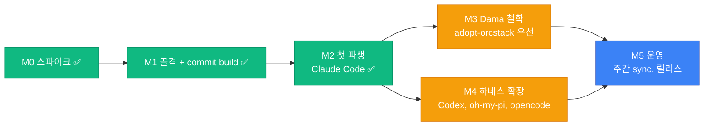

# orcstack 작업 계획

- 작성일: 2026-11-05
- 근거: [`boilerplate-plan.md`](boilerplate-plan.md)(무엇을), [`philosophy.md`](philosophy.md)(어떻게 판단하나)
- 상태: M3·M4 진행 전. M0·M1·M2 완료(2026-11-06)

이 문서는 임시 계획이다. 마일스톤이 끝날 때마다 결론을 Planning SSOT·ADR·guard로 옮기고, 끝난 마일스톤 절은 지운다. orcstack의 영속 기록은 이 문서가 아니라 `docs/planning/SSOT.md`와 `docs/adr/`다(M1에서 생성).

## 0. 진행 규칙

이 저장소도 orcstack-governed로 운영한다. 아직 orcstack이 없으므로 M0–M2는 규칙을 손으로 지킨다.

- **작업 항목 하나 = PR 하나.** 항목마다 acceptance(관찰 가능한 완료 조건)와 증거 종류(영구 guard / 일회성 증거)를 미리 적는다.
- **M1 이후 commit build를 지킨다.** `npm run check` 한 명령이 로컬과 CI에서 같은 Tier 0+1을 돌리고, red면 머지하지 않는다.
- **도구 테스트는 red-before-green.** guard를 추가하는 PR에는 그 guard가 실패하는 상태를 먼저 보인 증거를 남긴다.
- **스파이크(M0) 코드는 머지하지 않는다.** `spike/*` 브랜치나 scratch에서 돌리고, 결과(표·목록·결정)만 문서로 옮긴다. 운영 코드는 M1에서 새로 쓴다.
- **SDD 계열 도구를 이 저장소에서 쓰지 않는다.** 유저 전역에 `sdd-helper`와 `tmux-orchestrator`가 설치돼 있으므로 M1-1에서 프로젝트 설정으로 끈다. 그 전까지도 `specs/` 문서를 만들지 않는다.

## 1. 결정 사항

D1–D10은 권장안으로 채택해 [ADR-0002](adr/0002-m0-decisions.md)에 기록했다.

## 2. 마일스톤

초록은 완료, 노랑은 다음 차례다.

| 마일스톤 | 목표 | 종료 기준 | 예상 PR |
|---|---|---|---|
| M0 ✅ | 가정 실증 | 충족(2026-11-06). 4개 하네스 라우팅, 매핑 표 "확인 필요" 0개, 감지 신호 확정 | 문서 커밋 |
| M1 ✅ | 반복 가능한 파이프라인 | 충족(2026-11-06). `npm run check` 로컬·CI green, 잔존·dist stale·SDD 산출물이 각각 red, `main` 보호 | 커밋 8 + PR 1 |
| M2 ✅ | Claude Code에서 쓸 수 있는 orcstack | 충족(2026-11-06). GitHub 마켓플레이스 설치, 훅만으로 bug-fix·feature·refactoring 라우팅, `src/` 잔존 0 | PR 3 |
| M3 | orcstack 철학 구현 | SDD·Spec Kit·Superpowers 샘플 저장소 세 개가 `adopt-orcstack`으로 컷오버되고 재유입이 Tier 0에서 막힘. policy fork와 신규 skill 7개 반영 | 7 |
| M4 | 4개 하네스 | Codex·oh-my-pi·opencode 각각 배포본 설치 → `orc-mode` 진입 증거. 하네스별 대체 경로(todo, 훅 승인)를 README에 명시 | 4 |
| M5 | 유지 가능한 운영 | 주간 sync PR이 사람 개입 없이 생성됨. 첫 릴리스 태그. 첫 실제 upstream 갱신을 sync로 반영 | 4 |

M3와 M4는 M2 이후 병렬로 진행할 수 있다. 같은 파일(`build.mjs`, `harness/*.json`)을 건드리므로 PR은 작게 나누고 main에 자주 머지한다.

## 3. 작업 항목

각 항목의 "확인"은 완료를 판단하는 관찰 가능한 조건이다. 🔒는 영구 guard로 남는 것, 📎는 PR에 남기는 일회성 증거다.

### M0. 스파이크 ✅

완료(2026-11-06). 결과는 [`docs/spikes/`](spikes/)에 있고, 결론은 boilerplate-plan 2·3·6·7·9절에 반영했다. 이후 항목에 영향을 준 발견:

- 파생 후 손볼 곳은 통째 재작성 파일(README, guide, `orc-help`, `setup-orcstack`) 밖에서 17개 파일 35줄이다. 체크리스트는 [derive 잔존](spikes/derive-residue.md).
- 혼용 프레임워크는 저장소 파일만으로 감지된다. SDD와 Spec Kit은 `specs/` 안 파일 이름으로 구분한다([감지 신호](spikes/framework-signals.md)).
- Codex·oh-my-pi·opencode는 `.agents/skills/`와 `AGENTS.md`만으로 라우팅된다. 세션 훅은 Claude Code는 바로, Codex는 사용자 신뢰 승인 후 동작한다. oh-my-pi는 Claude 마켓플레이스 형식을 읽는다([하네스 실측](spikes/harness-mapping.md)).

### M1. 골격 + commit build ✅

완료(2026-11-06). 항목별 acceptance와 증거는 brief에 있다: [M1-1](briefs/m1-1-repo-baseline.md), [M1-2](briefs/m1-2-sync-config.md), [M1-3](briefs/m1-3-capability-tokens.md), [M1-4](briefs/m1-4-derive.md), [M1-5](briefs/m1-5-sync.md), [M1-6](briefs/m1-6-build.md), [M1-7](briefs/m1-7-validate.md), [M1-8](briefs/m1-8-ci.md). 이후 항목에 영향을 준 결과:

- 도구: `tools/derive.mjs`(파생), `tools/sync.mjs`(3-way sync, `--init` 반입), `tools/build.mjs`(배포본, `--check`), `tools/validate.mjs`·`tools/check-no-sdd.mjs`(Tier 0). `npm run check` 하나가 Tier 0+1이다.
- 결정: [ADR-0001](adr/0001-orcstack-governed.md)(운영 규칙), [ADR-0002](adr/0002-m0-decisions.md)(D1–D10), [ADR-0003](adr/0003-neutral-capability-tokens.md)(능력 토큰, 하네스별 렌더링).
- `c742dd6` 전체 파생 잔존은 107줄 134건이다. M2-2·M2-3이 이것을 0으로 만들어야 Tier 0이 통과한다.
- `main`은 ruleset으로 보호된다. 이제 작업 항목 하나가 PR 하나다.

### M2. 첫 파생 (Claude Code) ✅

완료(2026-11-06). brief: [M2-1~M2-3](briefs/m2-1-3-first-derive.md), [M2-4·M2-5](briefs/m2-4-5-claude-code.md). 이후 항목에 영향을 준 결과:

- upstream `README.md`, `LICENSE`, `docs/guide/`는 sync에서 뺐다. guide 재작성은 하지 않는다.
- fork가 19개다. M3 policy fork는 이미 fork된 `orc-mode` 파일 안에서 처리한다.
- `orc-mode`만 모델 자동 호출을 연다. 다른 skill은 `disable-model-invocation`을 유지하고 `orc-mode`가 경로로 읽는다. M4의 `AGENTS.md` 라우팅도 같은 전제다.
- 모델 시트 별칭은 리터럴 `inherit`다. `model-inherit` 능력은 없앴다(21개).

### M3. Dama 철학

**M3-1 `adopt-orcstack` (최우선)** ✅ ([brief](briefs/m3-1-adopt-orcstack.md))
- 결정적인 부분은 스크립트로: 감지, `docs/archive/<framework>/`로 이동과 FROZEN 헤더, 설정에서 플러그인 끄기, ADR-0001 초안, Tier 0 재유입 guard 설치.
- 판단이 필요한 부분은 skill 본문으로: 동결 문서에서 제품 의도만 골라 SSOT로 옮기기, 기술 결정은 ADR 후보로, 회귀 약속은 guard 후보로.
- fixture: [감지 신호](spikes/framework-signals.md) 표로 생성한다. Spec Kit은 버전을 pin한 `specify init`으로 재현하고, SDD·Superpowers는 문서 경로만 만든다. orcstack 인접 플러그인(`tmux-orchestrator`, `tdd-workflow`) 감지도 포함한다.
- 확인: 🔒 세 fixture 각각 감지 → 동결 → 재유입 시 red. 📎 실제 skill 실행 세션 기록 1개.

**M3-2 `orc-mode` policy fork와 게이트** ✅ ([brief](briefs/m3-2-orc-mode-gate.md)), 보강 ([brief](briefs/m3-2b-gate-hardening.md))
- 시작 단계에 SSOT·work brief 확인, 감지 신호가 있고 컷오버 ADR이 없으면 `adopt-orcstack`으로 라우팅, 다른 라우터 지시가 컨텍스트에 있으면 보고하고 멈춤.
- 확인: 📎 Superpowers가 켜진 저장소에서 `orc-mode`가 멈추는 세션 기록.

**M3-3 policy fork: 검증** ✅ ([brief](briefs/m3-3-4-policy.md)) — `tdd`, `correct`, `bug-fix`, `refactoring`
- crank/ratchet 구분, 가장 낮은 안정 계층, red-before-green 6단계, 비계 vs 울타리.

**M3-4 policy fork: 흐름과 기록** ✅ ([brief](briefs/m3-3-4-policy.md)) — `feature`, `prototype`, `multi-phase-plan`, `opening-a-pr`, `shipping`, `recall`, `session-pickup`, `pause-safely`
- acceptance 선정의, 프로토타입 머지 금지, 계획은 임시·SSOT는 영속, PR 본문 형식, Tier 3가 CI를 대신하지 않음, 결정 기록은 커밋.
- M3-3·M3-4 확인: 🔒 `forks.json` 등록과 sync 3-way 테스트 통과. 📎 fork 전후 diff 요약.

**M3-5 신규 skill: 지식** ✅ ([brief](briefs/m3-5-6-skills.md)) — `work-brief`, `adr`, `contract-inventory`, `cold-start-review`

**M3-6 신규 skill: 검증과 CI** ✅ ([brief](briefs/m3-5-6-skills.md)) — `ci-tiers`, `test-audit`
- `ci-tiers`는 하네스와 무관하게 GitHub Actions 템플릿을 만든다.

**M3-7 `templates/` 완성과 파일럿**
- SSOT, brief, ADR, Tier 0/1/2 워크플로, PR 템플릿, CODEOWNERS 예시.
- 파일럿: `sdd-helper`를 쓰는 orcstack 저장소 하나를 **복사본**에서 컷오버해 본다. 실제 저장소 적용은 그 저장소 소유자가 다음 마일스톤 경계에서 결정한다.
- 확인: 📎 파일럿 컷오버 결과와 cold-start 5문항 답.
- 파일럿 1차 ✅ ([기록](spikes/m3-7-pilot-synapse-backend.md)): `synapse-backend` 복사본. 컷오버는 동작했지만 cold-start 1·5번에 답하지 못했고, 개선점 P1~P9가 나왔다.

**M3-9 파일럿 반영** — [파일럿 기록](spikes/m3-7-pilot-synapse-backend.md)의 P1~P9.
- 우선: P3(gitignore된 개인 문서가 커밋되는 위험), P1(기존 기록 체계 채택), P2(pstack 라우터 감지), P5(컷오버 brief와 rollback).
- 다음: P4, P6(M4-5와 함께), P7, P8, P9. 남은 M3-7 템플릿(PR 템플릿, CODEOWNERS 예시)도 여기서 한다.
- 확인: 🔒 각 개선의 unit. 📎 같은 복사본에서 다시 컷오버해 cold-start 5문항이 모두 답해지는 기록.
- 진행: P3 ✅ (`freeze`·`guard`·`detect`가 git이 무시하는 파일을 건드리지 않고 따로 보고한다). P1 ✅ (`records`로 기존 SSOT·ADR·brief 체계 채택, [ADR-0005](adr/0005-project-record-layout.md)). P2·P7·P8 ✅ (pstack 라우터 감지, `tmux-orchestrator` 이유, orcstack ADR 참조). P4·P5·P9 ✅ (끊긴 참조 보고, 컷오버 brief와 되돌리기, 동결 헤더).
- 재검증 ✅: 2차 컷오버에서 cold-start 3·4·5번이 답해지고, 1·2번은 소유자 작성 대기 칸만 남았다. 이어서 R1~R4를 고쳤다.
- 결정(2026-11-06): synapse-backend는 orcstack으로 운영한다. 실제 컷오버는 P3·P1·P2·P5 반영과 복사본 재검증 뒤에 한다.

**M3-10 에이전트용 전환 가이드와 도구** — 1단계 ✅ ([brief](briefs/m3-10-agent-adoption.md), [ADR-0006](adr/0006-agent-adoption-entry.md)): `ADOPTING.md`, `tools/orcstack.mjs preflight|adopt|verify`. 2단계 `install --harness` ✅ (M4-3과 함께, ADR-0007).
- 목표: 에이전트에게 orcstack 저장소만 주면, 대상 프로젝트를 정리하고 orcstack으로 전환할 수 있게 한다. 플러그인을 설치하지 않은 에이전트도 같은 결과를 내야 한다.
- 계획에서 정할 것:
  - 진입점: orcstack 저장소의 어느 문서를 먼저 읽게 할지(예: 에이전트용 `ADOPTING.md`). 사람이 읽는 README(M4-4)와 나눈다.
  - 사전 점검: 대상의 git 상태, 진행 중인 작업과 마일스톤 경계, 하네스별 설치 상태, 무시된 개인 문서(P3).
  - 기존 기록 체계 조사: SSOT·ADR·brief·Feature Map의 경로와 형식(P1), 다른 라우터(P2), `AGENTS.md`의 상충 지시(P6).
  - 실행 단계: 대상에 하네스별 orcstack 설치, `adopt-orcstack` 단계 실행, 컷오버 brief와 rollback 기록(P5), 컷오버 PR.
  - 도구로 만들 부분과 가이드로 남길 부분: 결정적인 단계(점검, 조사 보고, 설치, 검증)는 orcstack 저장소의 CLI(`tools/`)로, 판단(의도 이전, 상충 해소)은 가이드와 skill로 둔다.
  - 사람 승인 지점: 마일스톤 경계, SSOT 내용, ADR 승인, 파일 이동, 원격 push와 PR.
  - 검증: synapse-backend 복사본에서 플러그인 없이 orcstack 저장소만으로 전환해 cold-start 5문항이 모두 답해지는지 본다.
- 산출: 계획 문서(`docs/plans/` 아님. brief와 ADR로 남긴다), 이어서 구현.

**M3-8 프로젝트 확장 지점** ✅ ([brief](briefs/m3-8-project-extensions.md), [ADR-0004](adr/0004-project-extensions.md)) (SSOT §4 F6, §6 C7)
- 배경: orcstack을 개별 프로젝트에 적용하면 모든 skill·playbook이 그 프로젝트와 맞지는 않는다. 대부분은 골라 쓰면 되지만, 특정 항목은 프로젝트가 자기 방식으로 바꾸고 싶어 한다.
- 설계(ADR-0004): 프로젝트 저장소의 `.orcstack/` 아래에 확장 지점을 둔다. 플러그인 파일은 고치지 않는다.
  - 선별: 프로젝트 설정 파일에서 skill·playbook을 끈다. 끈 항목은 `orc-mode`가 라우팅하지 않는다.
  - 확장: 기본 playbook 위에 프로젝트 규칙을 덧붙인다(예: 이 저장소의 bug-fix는 재현을 E2E로).
  - 대체: 프로젝트 playbook이 같은 이름의 기본 playbook을 대신한다.
  - 추가: 프로젝트 전용 playbook을 더한다. skill의 대체·추가는 orcstack skill을 끄고 하네스의 프로젝트 skill 디렉터리를 쓴다(ADR-0004).
  - 우선순위와 충돌 규칙: 프로젝트 > orcstack 기본. 혼용 금지(C5)와 출처 고지(C2)는 끌 수 없다.
- `orc-mode`가 라우팅 전에 `.orcstack/`를 읽는다. `adopt-orcstack scaffold`가 빈 확장 지점과 예시를 만든다. 프로젝트 guard가 설정 형식을 검사한다.
- 확인: 🔒 fixture 프로젝트에서 끈 playbook이 라우팅되지 않고, 대체 playbook이 기본 대신 쓰이고, 설정 오류가 guard에서 실패. 📎 실제 하네스에서 확장된 playbook으로 라우팅되는 세션 기록. orcstack을 다시 빌드·설치해도 `.orcstack/`가 그대로인 것.

### M4. 하네스 확장

[하네스 실측](spikes/harness-mapping.md)과 M1-3의 능력 표를 쓴다. 하네스마다 PR 하나.

**M4-1 Codex** ✅ ([brief](briefs/m4-1-codex.md)) — `dist/codex`, 루트 `.agents/plugins/marketplace.json`, `AGENTS.md` 라우팅(기본) + SessionStart 훅(사용자 신뢰 승인 후, 보조).
**M4-2 oh-my-pi** ✅ ([brief](briefs/m4-2-omp.md)) — `dist/omp`, 루트 `.claude-plugin/marketplace.json`에 `orcstack-omp` 항목. 훅 없음, `AGENTS.md` 라우팅.
**M4-3 opencode** ✅ ([brief](briefs/m4-3-opencode.md), [ADR-0007](adr/0007-harness-install.md)) — `dist/opencode`, 설치 스크립트(`.agents/skills` 링크 + `AGENTS.md` 조각). `.claude/skills`와 겹쳐 orc-mode가 두 번 보이는지 확인.
- M4-1~3 확인: 🔒 하네스별 dist 최신·미해결 토큰 0. 📎 설치 → `orc-mode` 진입 기록.

**M4-4 README 개편과 설치 문서** ✅ ([brief](briefs/m4-4-readme.md))
- README를 사용자 기준으로 다시 쓴다. 첫 화면에 orcstack이 무엇이고 누가 왜 쓰는지, 그다음 코딩 에이전트별 세팅 방법(Claude Code, Codex, oh-my-pi, opencode)을 둔다.
- 하네스마다 설치 명령, private 저장소 접근에 필요한 Git 인증, 호출 방법(`/orc-mode`, `$orc-mode`, 자연어), 라우팅 경로(훅 또는 `AGENTS.md`), 갱신과 제거, 알려진 격차를 적는다.
- Codex 훅 신뢰 승인 절차와, 승인 전에는 훅이 조용히 꺼져 있다는 점을 적는다.
- 프로젝트 도입 순서(`adopt-orcstack` → `.orcstack/config.json` 확장 → `ci-tiers`)와 첫 작업 예시를 둔다.
- 확인: 📎 각 하네스에서 README만 보고 설치한 기록.

**M4-5 모범 AGENTS.md** ✅ ([brief](briefs/m4-5-agents-md.md), [가이드](guides/agents-md.md))
- orcstack 프로젝트에 맞는 `AGENTS.md` 구조와 내용을 정한다. Codex·oh-my-pi·opencode에서는 `AGENTS.md`가 라우팅의 기본 경로이므로, 이 파일의 품질이 곧 라우팅 품질이다.
- 담을 것: 기준 문서 표(SSOT, ADR, brief, 철학), 작업 순서, orcstack 라우팅 블록, 금지 사항, 언어 규칙, 검증 명령(로컬과 CI가 같은 한 명령), 프로젝트 확장 위치(`.orcstack/`). 짧게 유지하고 상세는 링크한다.
- 기존 팀 `AGENTS.md`와 합치는 규칙: orcstack 블록은 `<!-- orcstack:begin/end -->` 안에만 쓰고 나머지는 보존한다.
- `adopt-orcstack` 템플릿(`agents-block.md`)과 이 저장소의 `AGENTS.md`에 반영하고, 문서로 예시를 남긴다.
- 확인: 🔒 `scaffold`가 만든 `AGENTS.md`의 구조 검사. 📎 세 하네스에서 그 `AGENTS.md`만으로 라우팅되는 기록. M3-7 파일럿의 `AGENTS.md`를 첫 사례로 쓴다.

### M5. 운영

**M5-1 주간 sync Action** ✅ ([brief](briefs/m5-1-weekly-sync.md), [운영 가이드](guides/upstream-sync.md)) — upstream `main` 최신 SHA로 `sync.mjs`, 변경이 있으면 충돌·신규 skill·삭제 목록을 담은 PR 생성. 머지는 사람이.
- 판단은 `tools/sync-pr.mjs`, git·gh 단계는 `.github/workflows/sync.yml`. 파생 결과가 그대로면(다른 플러그인만 바뀜) PR을 만들지 않는다. 충돌은 draft PR로 열고, 해결 뒤 `sync.mjs --resolved`로 pin을 옮긴다.
- 2026-11-06 실측: upstream `main`은 `2776ddd`까지 움직였지만 `pstack/` 트리는 pin `c742dd6`과 같다. 첫 실행 결과는 `none`이다.
- 조직 정책이 Actions의 PR 생성을 막아 `ORCSTACK_SYNC_TOKEN`(fine-grained PAT, orcstack 한정 Contents·Pull requests 쓰기)으로 PR을 연다. 2026-11-06 등록, 수동 실행에서 `HAS_SYNC_TOKEN: true`와 checkout 성공 확인. PR 생성 자체는 upstream이 처음 바뀌는 주에 확인된다.
**M5-2 릴리스** ✅ ([brief](briefs/m5-2-first-release.md), [가이드](guides/release.md)) — `VERSION`·매니페스트·CHANGELOG(`upstream: pstack <ver> (<sha>)` 병기) 갱신, 태그.
- `tools/release.mjs prepare`가 버전·CHANGELOG·`dist/`를 함께 올리고, `main`에 `VERSION`이 들어오면 `release.yml`이 태그와 Release를 만든다. tier0 validate가 버전 일치를 막는다. 첫 릴리스 `0.1.0`(upstream pstack 0.15.36, `c742dd6`).
**M5-3 Tier 2 nightly** ✅ ([brief](briefs/m5-3-tier2-nightly.md)) — 전체 테스트, M2-5 headless 스모크, 게이트 e2e(`tests/e2e/gate.mjs`, 가짜 fixture), 확장 e2e(`tests/e2e/extensions.mjs --case extend|off`), 가능한 하네스의 설치 스모크. 실제 Superpowers 확인은 릴리스 변경 시와 분기마다.
- `.github/workflows/tier2.yml`: 매일 03:00 KST·수동·`risk:high` PR. `check`, 네 하네스 설치 스모크(`tests/e2e/install-smoke.mjs`, drift 보고), model e2e(`routing.mjs`·`gate.mjs`·`extensions.mjs`)는 구독 토큰 `CLAUDE_CODE_OAUTH_TOKEN`(또는 `ANTHROPIC_API_KEY`)으로 주 1회. 로컬은 `npm run e2e:model`.
- 첫 실행에서 기능 요청 라우팅 결함을 찾았다 → M5-5.
**M5-4 첫 실제 upstream 갱신** ✅ ([brief](briefs/m5-4-pstack-0-15-42-model-setup.md)) — pstack `0.15.42`(`bf0c7cd`)를 `sync.mjs`로 반영했다. 첫 sync에서 갱신 22개, 추가 1개, 삭제 14개, 충돌 5개를 보고했고, 충돌 해결과 fork 등록 뒤 `--resolved`로 pin을 옮겼다. `setup-orcstack`은 하네스별 모델 카탈로그와 추론 예산을 사용한다.
**M5-5 기능 요청 라우팅 보강** ✅ ([brief](briefs/m5-5-playbook-routing.md)) — M5-3 라우팅 스모크에서 기능 요청이 `orc-mode`와 게이트까지 간 뒤 `feature.md`와 SSOT 확인 없이 바로 구현했다(2/2, sonnet). orc-mode의 playbook 선택 지시를 보강하고, `routing.mjs --case feature`를 반복 실행해 통과율로 확인한다.
- 원인: 게이트의 "SSOT 없는 저장소는 Do the task"가 남은 절차를 건너뛰라는 뜻으로 읽혔다. 게이트 뒤 playbook 단계를 명시했다. 반복 측정: 기능 0/3 → 4/5, 리팩터링 2/3 → 5/5. 버그·질문·끄기는 회귀 없음.
**M5-6 synapse-backend 적용 피드백** ✅ ([brief](briefs/m5-6-backend-feedback.md)) (2026-11-06, 소유자가 직접 설치하며 전달). GitHub 이슈로 올리려 했지만 작업 토큰에 이 저장소의 issues 권한이 없어 여기 기록한다.
- **B1 preflight 잡음:** `.claude/worktrees/` 안의 파일까지 로컬 SDD 문서로 센다.
  - 원인: `readRepository`(`signals.mjs`)가 `.git`·`node_modules`만 건너뛰고, 그 안에 있는 다른 git 작업 트리를 대상 저장소 파일로 읽는다. worktree가 git ignore 대상이면 `ignored-docs` 결정에 섞인다.
  - 고칠 방향: `.git` 파일이나 디렉터리를 가진 하위 디렉터리(다른 worktree·중첩 저장소)는 건너뛰고, 그 사실을 보고한다.
- **B2 Pi 배포본 없음:** orcstack은 oh-my-pi(`orcstack-omp`)만 배포한다. SSOT §5 비목표가 "upstream pi를 지원하지 않는다"이다.
  - 그런데 `preflight`가 `.pi`를 하네스로 보고해, 지원하는 것처럼 보인다.
  - 처리: SSOT §5 비목표를 유지했다. preflight는 `.pi`를 `unsupportedHarnesses`와 `pi-harness` 결정으로 보고한다. pi 배포본이 필요해지면 SSOT §5부터 고친다.
- **B3 guard 워크플로 중복 실행:** 설치되는 `orcstack-guard.yml`이 `push`(모든 브랜치)와 `pull_request`에서 돌아, PR 브랜치에서는 두 번 돈다. 대상의 CI 중복 제거 정책과 어긋난다(실행 비용은 작다).
  - 고칠 방향: `push`는 대상의 기본 브랜치로 한정한다. 기본 브랜치는 `adopt guard`가 `origin/HEAD`에서 읽는다.
  - 반영: orcstack 0.1.1. synapse-backend는 소유자가 guard를 다시 설치했다(synapse-backend #2156, 2026-11-06).

**M5-7 README 빠른 시작** ✅ ([brief](briefs/m5-7-readme-quickstart.md)) — 설치 → preflight → 전환 → verify → 갱신 뒤 `adopt guard` 순서와 preflight 결정 표를 README 위쪽에 둔다. 명령과 결정 id는 `tests/readme.test.mjs`가 CLI와 맞춘다.

**M5-8 orcstack 활용하기 가이드** ✅ ([brief](briefs/m5-8-using-orcstack.md)) — 도입 뒤 팀원이 매일 쓰는 법(요청, 게이트가 멈출 때, playbook, 기록, 검증, skill, 프로젝트 맞춤, 끄기·갱신, 문제 해결)을 `docs/guides/using-orcstack.md`에 둔다. 가이드의 skill·playbook 이름은 `tests/guides.test.mjs`가 확인한다.

- M5 확인: 📎 M5-4의 기록(upstream pstack이 처음 바뀔 때)과, philosophy 운영 지표 중 리드 타임·재작업률의 첫 측정 ✅ ([기록](spikes/m5-operating-metrics.md): 리드 타임 약 30분~2시간, 재작업률 19%, M5-5·M5-6 반영 후 Tier 2 수동 실행 green).

## 4. 리스크

| 리스크 | 신호 | 대응 |
|---|---|---|
| fork가 늘어 sync 비용이 커진다 | `forks.json` 항목이 15개 초과. **M2에서 이미 19개** | M3 policy fork는 이미 fork된 `orc-mode` 파일 안에서 처리해 새 fork를 늘리지 않는다. 철학 반영은 dama 전용 skill로 모은다 |
| upstream이 M2 전에 크게 바뀐다 | `c742dd6` 이후 커밋이 skill 구조를 바꿈 | pin은 M2 끝까지 `c742dd6` 고정. 갱신은 M5-4에서 sync로 한다 |
| 하네스 업데이트로 도구 이름·설치 방식이 바뀐다 | M0 실측과 다른 동작 (Codex는 측정 시점에 이미 0.166.0 업데이트 안내) | `harness/*.json`에 측정 버전을 기록하고, Tier 2 nightly 설치 스모크(M5-3)로 드리프트를 잡는다 |
| 이 저장소에서 SDD 습관이 새어 들어온다 | `specs/`나 계획 문서가 PR에 추가됨 | M1-7 guard가 막는다. 그 전에는 리뷰에서 막는다 |

## 5. 바로 할 일

1. synapse-backend 실제 컷오버 ✅: 소유자가 직접 진행해 머지했다(synapse-backend #2153 ADR-079, 후속 #2154·#2155, 0.1.1 반영 #2156). 앞으로 나오는 피드백은 M5-6처럼 받아 고친다
2. M5: M5-1 sync PR 생성은 upstream pstack이 처음 바뀌는 주에 확인한다(M5-4)
